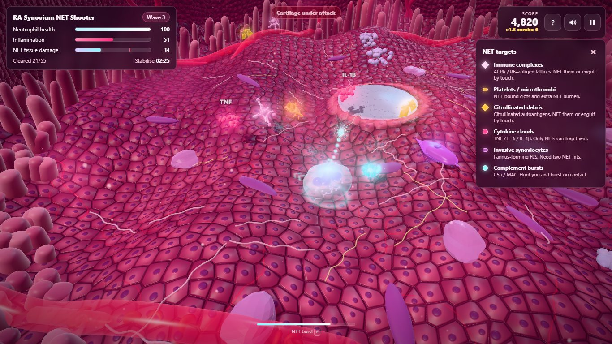
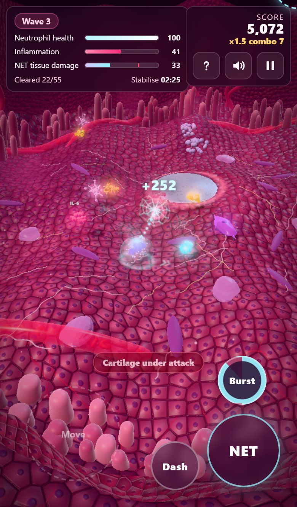

# RA Synovium NET Shooter

An educational 3D arcade game set inside an inflamed rheumatoid arthritis (RA) joint. You steer an activated **neutrophil** across the synovial lining and trap inflammatory stimuli with **neutrophil extracellular traps (NETs)** before they reach the articular cartilage. The catch is that every NET leaves chromatin webbing behind, so releasing too many damages the tissue you are protecting.

Runs in any modern browser on desktop, tablet and phone (WebGL 2). There is nothing to install and no image or audio files are downloaded: all textures, models and sounds are generated procedurally at start-up.





## How to play

Protect the cartilage at the centre of the joint. Stimuli extravasate from the vessels at the edge of the cavity and drift inwards.

| Meter | What raises it | What it does |
| --- | --- | --- |
| **Neutrophil health** | Complement bursts, invasive synoviocytes, engulfing particles, NET overload | Reaches 0 → the neutrophil undergoes NETosis (game over). Regenerates slowly when you avoid damage. |
| **Inflammation** | Time, and every stimulus that reaches the cartilage | Reaches 100 → inflammation runaway. Each capture lowers it. |
| **NET tissue damage** | Every NET released; NET–platelet clots, NET-bound debris and NET-exposed synoviocytes add extra | Above 72 it injures you and inflames the tissue; reaching 100 ends the run. Decays slowly. |

**Win** by stabilising the synovium for 2:30 or clearing 55 stimuli. Captures in quick succession build a **combo** multiplier and charge a radial **NET burst**. Touch immune complexes or debris to **phagocytose** them without releasing a NET.

### Targets

| Target | Behaviour |
| --- | --- |
| Immune complexes (ACPA / RF–antigen lattices) | Drift to the cartilage; NET them or engulf by touch |
| Platelet microthrombi | Slow; NET captures add extra NET burden |
| Citrullinated debris | Autoantigen fragments; NET them or engulf by touch |
| Cytokine clouds (TNF / IL-6 / IL-1β) | Slow; only NETs can trap them |
| Invasive synoviocytes (pannus-forming FLS) | Crawl along the lining; need two NET hits; shove and injure on contact |
| Complement bursts (C5a / MAC) | Hunt the neutrophil and burst on contact |

### Controls

| | Keyboard & mouse | Touch | Gamepad |
| --- | --- | --- | --- |
| Move | `W A S D` / arrow keys | Drag anywhere on the left half (floating joystick) | Left stick |
| Aim | Mouse (auto-aim if you only use the keyboard) | Auto-aim, or tap a target | Right stick (auto-aim otherwise) |
| Fire NET | Click / hold, or `Space` | Hold **NET** | Right stick, RT |
| Dash | `Shift` | **Dash** | B / LB |
| NET burst | `E` or right-click | **Burst** | Y / RB |
| Pause | `Esc` / `P` | ❚❚ button | Start |
| Mute | `M` | 🔊 button | — |

Controls follow the device you are actually using: touch controls appear when you touch the screen, and they switch back when you use a mouse or a gamepad. The game pauses automatically when the tab or app loses focus. On phones it works in portrait and landscape, and it can be added to the home screen to play fullscreen.

## Graphics

- Procedural synovial lining: cobblestone lining cells with nuclei, a capillary network, hypoxic patches, and colours that react to inflammation and NET burden in real time
- Joint capsule with hypertrophic villous fronds swaying in synovial fluid, new blood vessels with red blood cells flowing through them, resident macrophages, fibroblast-like synoviocytes, ectopic lymphoid aggregates and crimped collagen and fibrin fibres
- Articular cartilage with chondrocyte lacunae that visibly erodes as stimuli reach it
- Translucent neutrophil with a multilobed nucleus and granules; its membrane ruffles and pushes out a pseudopod in the direction it moves
- Each target is a single-draw-call model (antibody "Y" lattices, platelet clots bound by fibrin, TNF-style trimers, MAC pores, and so on)
- Bloom, fresnel rim lighting, soft shadows, particles, shockwaves, and NET webs that stay on the tissue
- **Graphics quality** (Settings): Auto, High, Medium or Low. Auto starts at Medium on phones and High on desktops, and drops a level if the frame rate stays below 40 fps.

## Development

```bash
npm install
npm run dev        # http://127.0.0.1:5173
npm run build      # production build in dist/
npm run preview    # serve dist/ at http://127.0.0.1:4173
npm run smoke      # headless desktop + phone smoke test against the preview server
npm run deploy     # build and publish dist/ to the gh-pages branch
```

`npm run smoke` needs Playwright's Chromium (`npx playwright install chromium`). It accepts a URL to test the dev server instead: `npm run smoke -- http://127.0.0.1:5173/`. Add `?debug` to the game URL to expose the game object as `window.__game`, and `?quality=low|medium|high` to force a quality level.

### Project structure

```
src/
  main.js                 entry point, WebGL 2 check
  style.css               HUD, menus, touch controls (responsive, safe-area aware)
  game/
    Scene.js              game loop, state machine, combat, biology meters, camera
    config.js             all tuning values, target definitions, quality presets, facts
    Environment.js        procedural joint cavity (floor, capsule, villi, vessels, cells)
    PlayerNeutrophil.js   player model and movement
    Targets.js            target model factories and behaviour
    NETProjectile.js      pooled NET projectiles
    Input.js              keyboard, mouse, multi-touch joystick/buttons, gamepad
    UI.js                 HUD, menus, floating text, off-screen threat indicators
    Effects.js            particles, shockwave rings, NET residue
    PostFX.js             bloom pipeline
    materials.js          shader injections (rim light, membrane, villi, floor, cartilage)
    textures.js           procedural canvas textures
    terrain.js            synovial surface height function
    Audio.js              Web Audio synthesised sound effects
    storage.js            safe localStorage for settings and best score
public/                   icons and web app manifest
scripts/smoke-test.mjs    Playwright smoke test
```

## Scientific note

This is a simplified, educational arcade model, not a clinical or mechanistic simulation. Game mechanics draw on published themes in RA and NET biology: NETs as a source of citrullinated autoantigens, NET–platelet thrombo-inflammation, fibroblast-like synoviocytes internalising NET components, aggregated NETs degrading cytokines, pannus eroding cartilage, and synovial angiogenesis. Magnitudes and timings are tuned for play, not taken from data.
